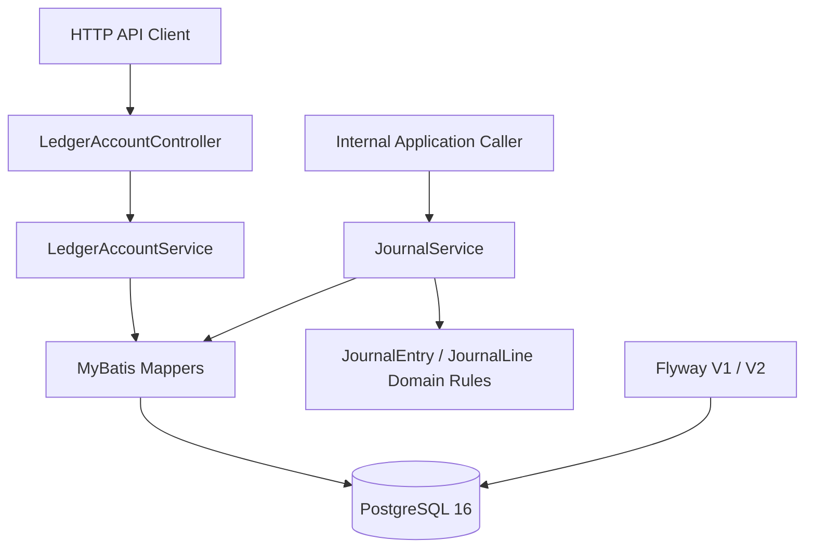
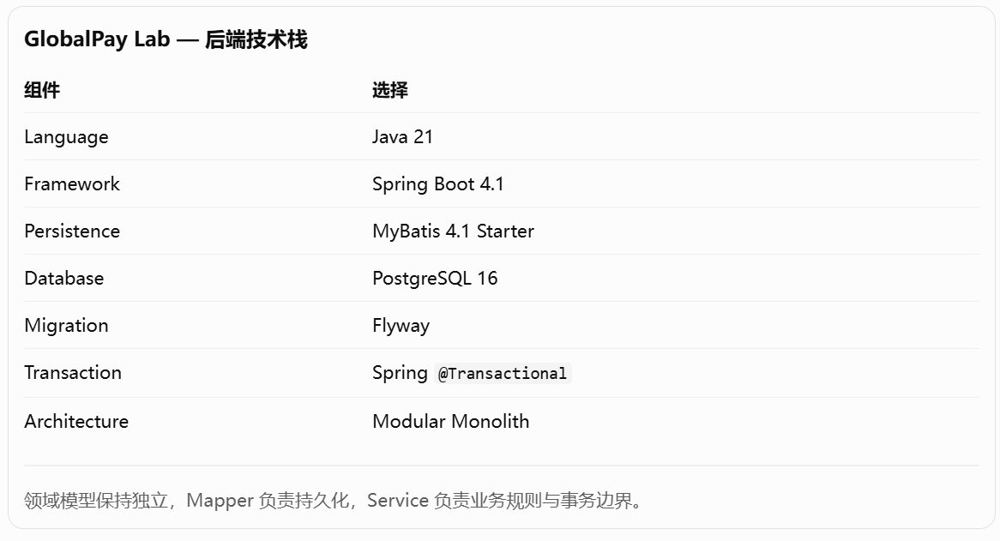
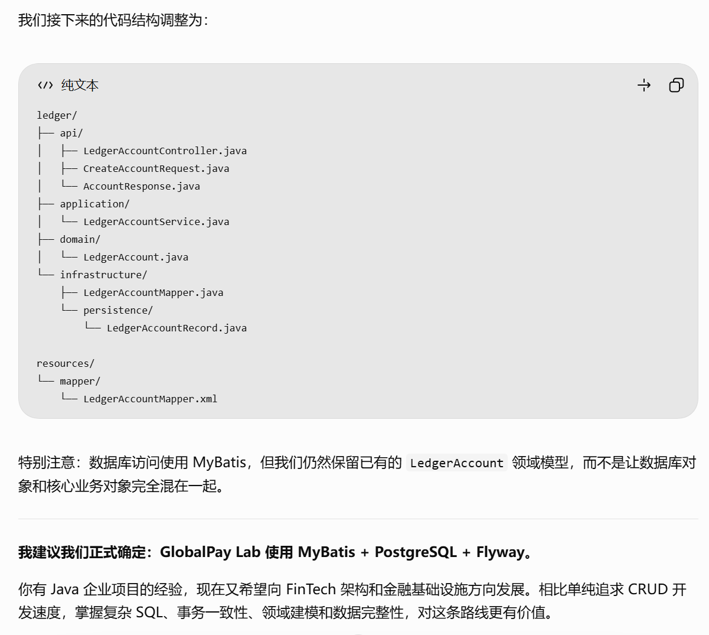
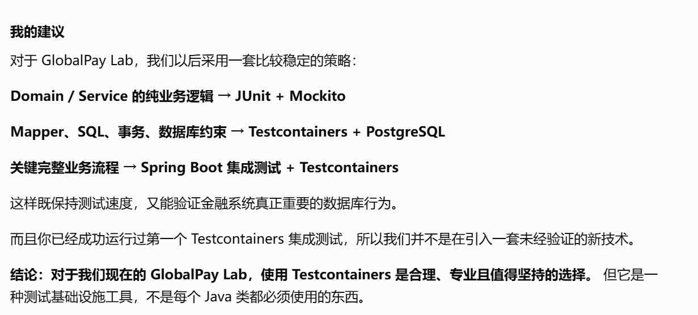
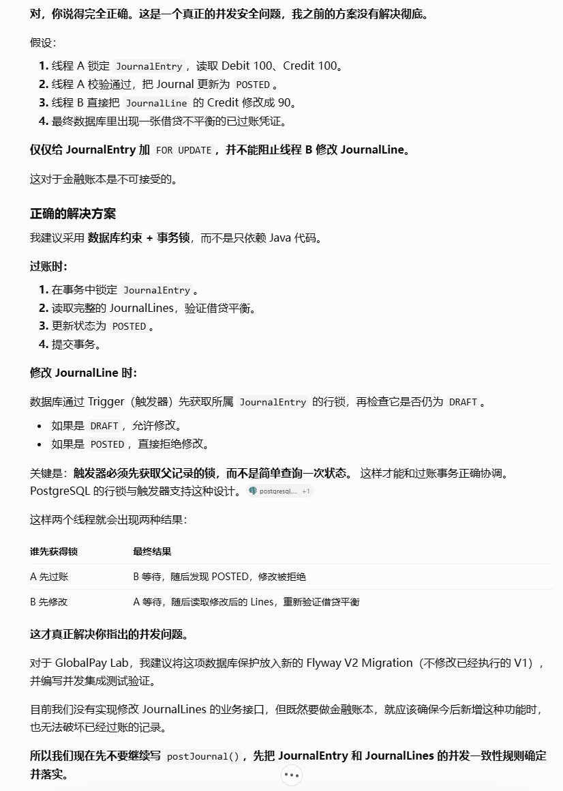
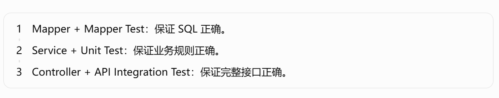

# GlobalPay Lab

**Cross-border Payments, Ledger & Automated Reconciliation Platform**

GlobalPay Lab is an educational FinTech sandbox for exploring the engineering behind cross-border payment infrastructure. The project is built incrementally: a reliable double-entry ledger first, followed by simulated payment processing, settlement, reconciliation, and operational tooling.

> **Current status:** M1 — Ledger Core implementation and automated CI verification are complete. Architecture/API documentation is being finalised in Issue #10. M2 (Payment MVP) has not started.
>
> **Sandbox only:** This project does not move real funds, store real card data, provide regulated financial services, or claim production compliance.

## Product scenario

Frank Global Commerce Pty Ltd is a fictional merchant operating in Australia, Singapore, and the United States. Its longer-term requirements motivate the project:

- Accept simulated payments in AUD, SGD, and USD.
- Track merchant balances using auditable double-entry bookkeeping.
- Prevent duplicate payment processing.
- Reconcile internal transactions against external settlement records.
- Investigate payment and reconciliation exceptions.

These are **product goals**, not a claim that every capability is implemented today.

## Implemented: M1 Ledger Core

The current backend provides:

- **Ledger accounts:** Create, retrieve, and list accounts with owner, currency, account type, and status.
- **Double-entry journals:** Create drafts and post validated journals through internal application services.
- **Posting rules:** Require at least two lines, positive line amounts, matching debit/credit totals, valid active accounts, and matching journal/account currencies.
- **Atomic posting:** Spring-managed transactions and PostgreSQL row locking for journal posting.
- **Immutable posted records:** PostgreSQL triggers protect posted journals and their lines against later mutation.
- **Derived balances:** Compute balances from `POSTED` journal lines, accounting for debit-normal and credit-normal account types.
- **Journal history:** Query posted journal-line history by ledger account.
- **Automated verification:** Unit and integration tests, PostgreSQL Testcontainers, and GitHub Actions CI for pull requests targeting `dev`.

**Not yet implemented:** Public journal creation/posting REST endpoints, payment processing, wallets, refunds, webhooks, settlement, reconciliation, FX, risk engine, and production deployment.

## Technology stack

| Area | Current implementation |
| --- | --- |
| Backend | Java 21, Spring Boot 4.1, Maven |
| Persistence | MyBatis, PostgreSQL 16, Flyway |
| Backend testing | JUnit, Spring Boot Test, Mockito, Testcontainers |
| Frontend foundation | React, TypeScript, Vite |
| Frontend tooling | Node.js 24, npm, ESLint |
| CI | GitHub Actions: backend build/tests and frontend lint/build |

### Current Ledger Core structure



This is currently a Spring Boot modular monolith. The `ledger` package separates API, application, domain, and infrastructure concerns. `JournalService` is called internally; **no public journal posting HTTP endpoint exists yet**.

For the detailed domain model, ERD, debit/credit rules, and journal posting sequence, see [Ledger Core Architecture](docs/architecture/ledger-core.md).

## Ledger REST APIs

The implemented HTTP endpoints share the base path `/api/v1/ledger/accounts`:

| Method | Path | Purpose |
| --- | --- | --- |
| `POST` | `/api/v1/ledger/accounts` | Create an account |
| `GET` | `/api/v1/ledger/accounts` | List accounts |
| `GET` | `/api/v1/ledger/accounts/{id}` | Get an account |
| `GET` | `/api/v1/ledger/accounts/{id}/balance` | Calculate the posted balance |
| `GET` | `/api/v1/ledger/accounts/{id}/journals` | Get posted journal-line history |

Example request after starting the backend:

```bash
curl -X POST http://localhost:8080/api/v1/ledger/accounts \
  -H 'Content-Type: application/json' \
  -d '{"ownerType":"MERCHANT","ownerId":"merchant-001","currency":"AUD","accountType":"LIABILITY"}'
```

The backend uses a JSON `Response<T>` envelope with `code`, `message`, and optional `data`. Currently, handled business/validation errors return application error codes in the JSON body while the HTTP status may still be `200`.

See [Ledger API Reference](docs/api/ledger-api.md) for full request/response examples and internal journal service usage.

## Run locally

### Requirements

- **JDK 21**
- **Docker Engine / Docker Desktop** (running)
- **Git**
- **Node.js 24 and npm** (only needed to build or run the frontend)

The project provides a Maven wrapper in `backend/`, so a separate Maven installation is not required for local development.

### 1. Start PostgreSQL

From the repository root:

```bash
docker compose up -d postgres
```

The supplied `docker-compose.yml` starts PostgreSQL 16 with these **development-only** defaults:

| Setting | Value |
| --- | --- |
| Host | `localhost` |
| Port | `15432` |
| Database | `globalpay` |
| Username | `globalpay` |
| Password | `globalpay_dev_only` |

The backend reads `DB_URL`, `DB_USERNAME`, and `DB_PASSWORD` if provided, otherwise uses these local defaults. Flyway applies the ledger schema and protection migrations (V1 and V2) at application startup.

### 2. Start the backend

**Windows (PowerShell):**

```powershell
cd backend
.\mvnw.cmd spring-boot:run
```

**macOS / Linux:**

```bash
cd backend
./mvnw spring-boot:run
```

By default, the backend listens on `http://localhost:8080`.

To make a quick read request after startup:

```bash
curl http://localhost:8080/api/v1/ledger/accounts
```

To stop the development database later, run `docker compose down` from the repository root. This leaves its named data volume intact.

### 3. Run backend tests

Keep **Docker Engine running**, then from `backend/`:

**Windows (PowerShell):**

```powershell
.\mvnw.cmd clean verify
```

**macOS / Linux:**

```bash
./mvnw clean verify
```

The database integration tests use **Testcontainers** to start their own PostgreSQL instance. You do **not** need to run `docker compose up` just to execute the test suite.

### 4. Frontend checks (optional during M1)

From the repository root:

```bash
cd frontend
npm ci
npm run lint
npm run build
```

To run the Vite development server, use `npm run dev`. The frontend is currently a foundation for future milestones rather than a completed payment operations UI.

## CI and development workflow

GitHub Actions runs on **pull requests targeting `dev`**:

1. **Backend Build & Tests:** Java 21, `mvn clean verify`.
2. **Frontend Lint & Build:** Node.js 24, `npm ci`, `npm run lint`, `npm run build`.

The repository also has a GitHub Ruleset protecting `dev` and requiring both checks before merge. A direct push by itself is not configured as a CI trigger in the current workflow.

Development flow: feature branch → pull request into `dev` → passing CI → merge.

## Roadmap

| Milestone | Status | Intended outcome |
| --- | --- | --- |
| **M1 — Ledger Core** | Documentation in progress | Auditable double-entry ledger, queries, integration tests, CI, documentation |
| **M2 — Payment MVP** | Planned | Sandbox payment lifecycle and payment-to-ledger integration |
| **M3 — Operations & Reconciliation** | Planned | Settlement, automated reconciliation, operations visibility |
| **M4 — Deployed Release** | Planned | Hosted demo, monitoring, deployment automation, and product documentation |

The full scope and milestones are maintained in the [development roadmap](docs/product/roadmap.md).

## Documentation

### Implemented Ledger Core

- [Ledger Core Architecture](docs/architecture/ledger-core.md) — architecture, ERD, double-entry rules, invariants, posting flow, and balance calculation.
- [Ledger API Reference](docs/api/ledger-api.md) — current HTTP endpoints, examples, response conventions, and internal journal operations.

### Product plans and earlier design proposals

The following documents describe **planned capabilities or early design assumptions** and should not be interpreted as a list of implemented APIs:

- [Project Charter](docs/product/project-charter.md)
- [MVP Scope](docs/product/mvp-scope.md)
- [Out of Scope](docs/product/out-of-scope.md)
- [Development Roadmap](docs/product/roadmap.md)
- [System Context](docs/architecture/system-context.md)
- [Proposed Payment Flow](docs/architecture/payment-flow.md)
- [Initial API Draft](docs/api/initial-api-draft.md)
- [Payment Ecosystem Notes](docs/domain/payment-ecosystem.md)

## Engineering diagrams and development notes

The diagrams below are retained from the original README for reference. They document early design ideas, testing strategy, CI, and technical investigations; some reflect work in progress rather than current implementation.

### Earlier design diagrams






### Testing strategy



### CI workflow


### Journal entry concurrency investigation



### Layered testing



## Disclaimer

GlobalPay Lab is a learning and portfolio project. All financial scenarios and transactions are simulated. It is not a licensed payment service and should not be used to process real money or sensitive cardholder data.
