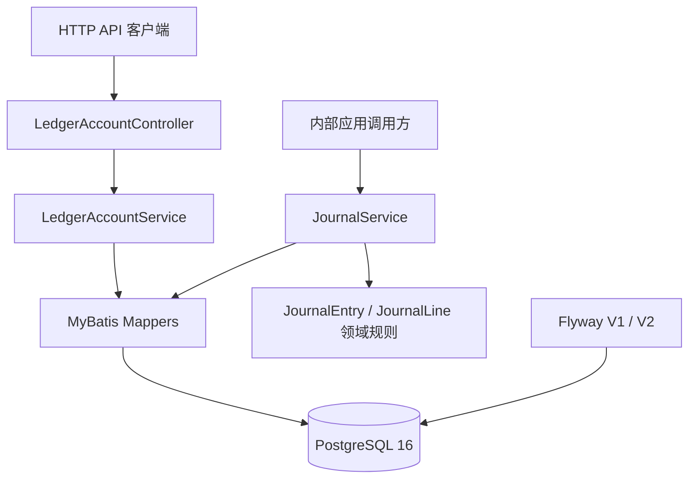

# GlobalPay Lab

**跨境支付、复式记账账本与自动化对账平台**

GlobalPay Lab 是一个用于学习和展示金融科技（FinTech）工程实践的沙盒项目，重点探索跨境支付基础设施背后的系统设计与实现。项目采用渐进式开发：首先实现可靠的复式记账账本（Ledger），随后逐步加入模拟支付处理、清结算、对账和运营管理功能。

> **当前进度：** M1 — Ledger Core 的主要功能开发和自动化 CI 验证已经完成；架构与 API 文档正在通过 Issue #10 收尾。M2（Payment MVP）尚未开始。
>
> **仅供沙盒使用：** 本项目不处理真实资金、不存储真实银行卡数据、不提供受监管的金融服务，也不宣称达到生产环境的合规要求。

## 业务场景

Frank Global Commerce Pty Ltd 是一家虚构的跨国商户，在澳大利亚、新加坡和美国开展业务。以下长期需求是项目设计的出发点：

- 支持 AUD、SGD 和 USD 等币种的模拟支付。
- 通过可审计的复式记账体系追踪商户余额。
- 防止重复支付处理。
- 将内部交易记录与外部结算记录进行对账。
- 调查支付异常与对账差异。

以上是**产品目标**，并不代表所有功能都已实现。

## 已实现：M1 Ledger Core

当前后端已具备以下能力：

- **账本账户管理：** 创建、查询和列出账本账户，记录所有者、币种、账户类型与状态。
- **复式记账分录：** 通过内部应用服务创建草稿分录（Draft Journal），并对符合要求的分录进行过账（Posting）。
- **过账校验：** 要求至少两条分录明细、金额大于零、借贷总额相等、关联账户存在且为 ACTIVE 状态，以及账户币种与 Journal 币种一致。
- **原子性过账：** 使用 Spring 事务和 PostgreSQL 行级锁保障 Journal 过账过程。
- **已过账记录不可变：** 通过 PostgreSQL Trigger 防止修改已经过账的 Journal 及其明细。
- **动态余额计算：** 基于状态为 `POSTED` 的 Journal 明细计算账户余额，并根据不同账户类型处理借方或贷方正常余额规则。
- **历史流水查询：** 按账本账户查询已经过账的 Journal Line 历史记录。
- **自动化验证：** 使用单元测试、集成测试、PostgreSQL Testcontainers，以及针对 `dev` 分支 Pull Request 的 GitHub Actions CI。

**尚未实现：** 对外公开的 Journal 创建／过账 REST API、支付处理、钱包、退款、Webhook、清结算、自动对账、外汇（FX）、风控引擎及生产环境部署。

## 技术栈

| 领域 | 当前使用的技术 |
| --- | --- |
| 后端 | Java 21、Spring Boot 4.1、Maven |
| 数据访问与存储 | MyBatis、PostgreSQL 16、Flyway |
| 后端测试 | JUnit、Spring Boot Test、Mockito、Testcontainers |
| 前端基础 | React、TypeScript、Vite |
| 前端工具链 | Node.js 24、npm、ESLint |
| 持续集成 | GitHub Actions：后端构建与测试、前端 Lint 与构建 |

### 当前 Ledger Core 架构



当前项目采用基于 Spring Boot 的**模块化单体架构（Modular Monolith）**。`ledger` 包按照 API、Application、Domain 和 Infrastructure 划分职责。`JournalService` 目前由内部代码调用，**尚未对外提供 Journal Posting 的 HTTP 接口**。

详细的领域模型、ERD、借贷规则及 Journal Posting 时序图，请参阅 [Ledger Core 架构设计](docs/architecture/ledger-core.md)。

## Ledger REST API

已实现的 HTTP 接口均以 `/api/v1/ledger/accounts` 为基础路径：

| 方法 | 路径 | 功能 |
| --- | --- | --- |
| `POST` | `/api/v1/ledger/accounts` | 创建账本账户 |
| `GET` | `/api/v1/ledger/accounts` | 获取账户列表 |
| `GET` | `/api/v1/ledger/accounts/{id}` | 查询指定账户 |
| `GET` | `/api/v1/ledger/accounts/{id}/balance` | 计算已过账余额 |
| `GET` | `/api/v1/ledger/accounts/{id}/journals` | 查询已过账的 Journal 明细历史 |

启动后端后，可使用以下命令创建账户：

```bash
curl -X POST http://localhost:8080/api/v1/ledger/accounts \
  -H 'Content-Type: application/json' \
  -d '{"ownerType":"MERCHANT","ownerId":"merchant-001","currency":"AUD","accountType":"LIABILITY"}'
```

后端统一使用包含 `code`、`message` 和可选 `data` 字段的 JSON `Response<T>` 结构。当前设计中，业务错误或参数校验错误通过 JSON 响应体中的应用错误码表达，HTTP 状态码仍可能是 `200`。

完整的请求／响应示例以及内部 Journal Service 调用说明，请参阅 [Ledger API 文档](docs/api/ledger-api.md)。

## 本地运行

### 环境要求

- **JDK 21**
- **Docker Engine / Docker Desktop**（已启动）
- **Git**
- **Node.js 24 和 npm**（仅在构建或运行前端时需要）

`backend/` 目录内已包含 Maven Wrapper，因此本地开发不必单独安装 Maven。

### 1. 启动 PostgreSQL

在项目根目录执行：

```bash
docker compose up -d postgres
```

项目中的 `docker-compose.yml` 使用 PostgreSQL 16，并配置了以下**仅供本地开发**的默认参数：

| 配置项 | 默认值 |
| --- | --- |
| 主机 | `localhost` |
| 端口 | `15432` |
| 数据库 | `globalpay` |
| 用户名 | `globalpay` |
| 密码 | `globalpay_dev_only` |

如果设置了环境变量 `DB_URL`、`DB_USERNAME` 和 `DB_PASSWORD`，后端会优先读取这些值；否则使用上述本地默认配置。应用启动时，Flyway 会自动执行 Ledger 数据库建表及保护约束迁移（V1、V2）。

### 2. 启动后端

**Windows（PowerShell）：**

```powershell
cd backend
.\mvnw.cmd spring-boot:run
```

**macOS / Linux：**

```bash
cd backend
./mvnw spring-boot:run
```

默认情况下，后端服务地址为 `http://localhost:8080`。

启动后可以发送一个简单的查询请求：

```bash
curl http://localhost:8080/api/v1/ledger/accounts
```

结束本地开发后，可以回到项目根目录执行 `docker compose down` 停止数据库容器；这一操作不会删除 Docker 的具名数据卷。

### 3. 运行后端测试

保持 **Docker Engine 运行**，然后在 `backend/` 目录执行：

**Windows（PowerShell）：**

```powershell
.\mvnw.cmd clean verify
```

**macOS / Linux：**

```bash
./mvnw clean verify
```

数据库集成测试通过 **Testcontainers** 自动启动独立的 PostgreSQL 容器。因此，**仅运行测试时，无须预先执行 `docker compose up`**。

### 4. 前端检查（M1 阶段可选）

从项目根目录进入 `frontend/`：

```bash
cd frontend
npm ci
npm run lint
npm run build
```

执行 `npm run dev` 可以启动 Vite 开发服务器。目前前端仍是为后续里程碑准备的基础工程，尚不是完整的支付运营管理系统。

## CI 与开发流程

当创建或更新**目标分支为 `dev` 的 Pull Request** 时，GitHub Actions 会执行：

1. **Backend Build & Tests：** 使用 Java 21，执行 `mvn clean verify`。
2. **Frontend Lint & Build：** 使用 Node.js 24，执行 `npm ci`、`npm run lint` 和 `npm run build`。

仓库也已为 `dev` 配置 GitHub Ruleset，要求上述两项检查通过后才能合并代码。目前 CI Workflow 没有为直接 Push 配置单独的触发事件。

推荐开发流程：**Feature Branch → Pull Request（目标为 `dev`）→ CI 通过 → Merge**。

## 开发路线图

| 里程碑 | 状态 | 预期成果 |
| --- | --- | --- |
| **M1 — Ledger Core** | 文档收尾中 | 可审计的复式记账账本、余额及流水查询、集成测试、CI 和技术文档 |
| **M2 — Payment MVP** | 计划中 | 模拟支付生命周期及 Payment 与 Ledger 集成 |
| **M3 — Operations & Reconciliation** | 计划中 | 清结算、自动对账和运营可视化 |
| **M4 — Deployed Release** | 计划中 | 在线演示、监控、部署自动化及产品文档 |

详细的范围与里程碑规划参见 [开发路线图](docs/product/roadmap.md)。

## 项目文档

### 已实现的 Ledger Core

- [Ledger Core 架构设计](docs/architecture/ledger-core.md)：系统架构、ERD、复式记账规则、业务不变量、过账流程和余额计算。
- [Ledger API 文档](docs/api/ledger-api.md)：当前 HTTP 接口、请求与响应示例、响应约定及内部 Journal 操作。

### 产品规划与早期设计方案

以下文件描述**计划中的功能或早期设计假设**，不能将其视为已经实现的 API 清单：

- [项目章程（Project Charter）](docs/product/project-charter.md)
- [MVP 范围（MVP Scope）](docs/product/mvp-scope.md)
- [范围外事项（Out of Scope）](docs/product/out-of-scope.md)
- [开发路线图（Development Roadmap）](docs/product/roadmap.md)
- [系统上下文（System Context）](docs/architecture/system-context.md)
- [拟议支付流程（Proposed Payment Flow）](docs/architecture/payment-flow.md)
- [初版 API 草案（Initial API Draft）](docs/api/initial-api-draft.md)
- [支付生态笔记（Payment Ecosystem Notes）](docs/domain/payment-ecosystem.md)

## 工程图示与开发笔记

以下图片保留自原始 README，供设计回顾使用。它们记录了早期设计思路、测试策略、CI 以及技术问题排查过程；部分内容属于开发中的探索，不完全代表当前已经落地的功能。

### 早期系统设计图


### 测试策略


### CI 工作流


### JournalEntry 并发问题分析（TODO）


### 分层测试


## 免责声明

GlobalPay Lab 是一个学习和求职作品集项目，所有金融业务场景及交易均为模拟。本项目不是持牌支付服务，不应被用于处理真实资金或敏感的银行卡持卡人数据。
