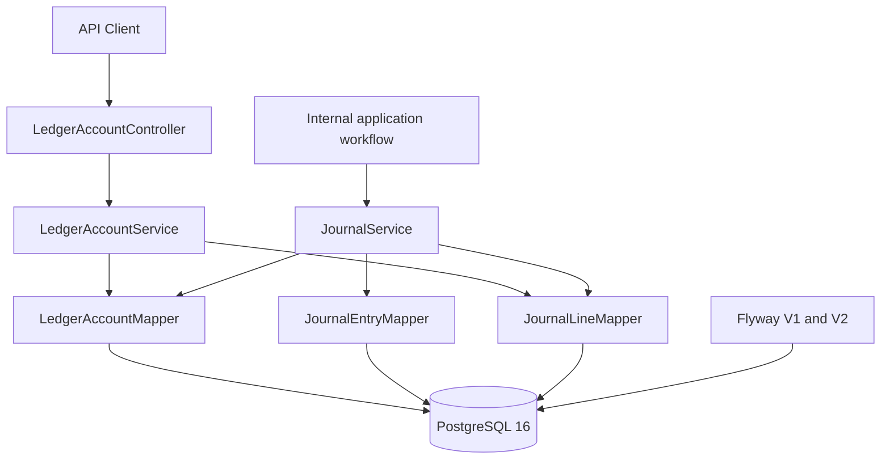
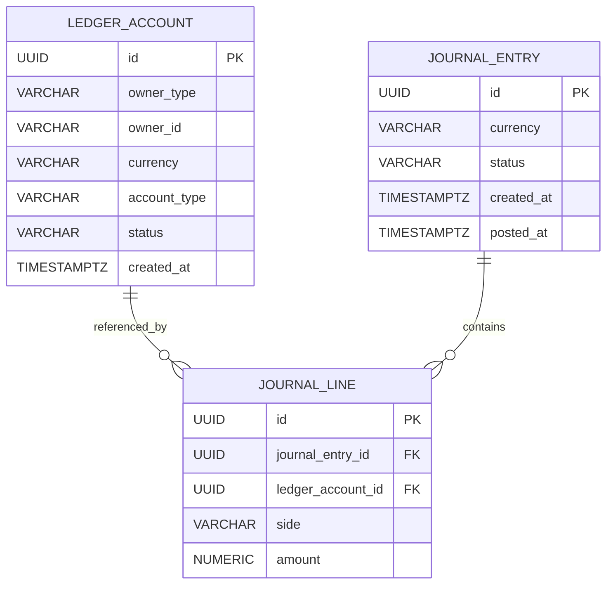
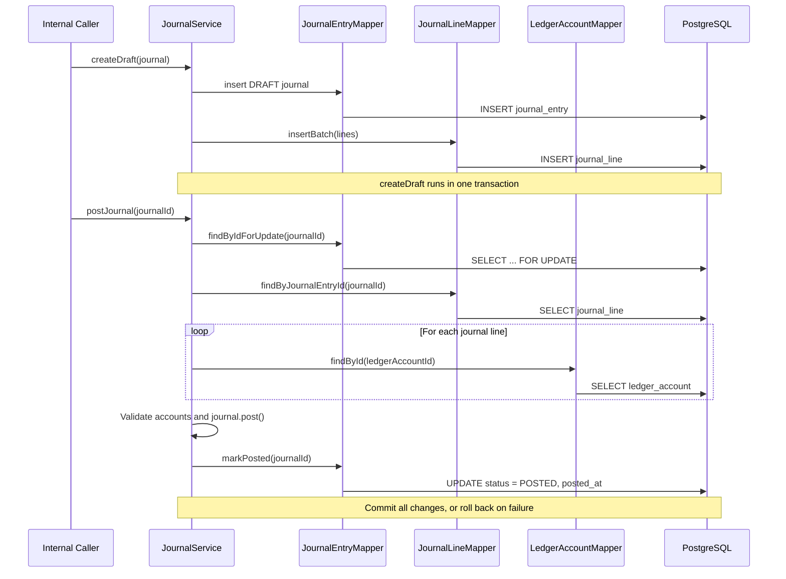

# Ledger Core Architecture

> **GlobalPay Lab · Milestone M1 · Issue #10**  
> Implementation reference: `backend/src/main/java/com/globalpay/lab/ledger` and Flyway migrations V1–V2.  
> Scope: the **implemented** Ledger Core, not planned payment, settlement, FX, risk, or reconciliation features.

## 1. Overview

GlobalPay Lab's Ledger Core records financial movements using **double-entry bookkeeping**. It supports ledger account creation and retrieval, draft journal creation, validated journal posting, derived account balances, and posted journal-line history.

The Ledger Core is part of a Spring Boot **modular monolith** backed by PostgreSQL. It records simulated financial movements; GlobalPay Lab does not process real funds.

Key design decisions:

- **JournalEntry** is the accounting aggregate: a `DRAFT` journal can contain zero or more **JournalLines**, while posting requires at least two lines.
- Every posted journal must have **equal total debit and credit** amounts.
- A journal is posted **atomically** using a Spring-managed database transaction.
- **Posted** journals and their lines are protected from modification by PostgreSQL triggers.
- Account balances are **computed from posted journal lines**, not maintained as a mutable balance column.
- Monetary values use Java `BigDecimal` and PostgreSQL `NUMERIC(24,8)`.

## 2. Application Architecture



| Package / component | Responsibility |
|---|---|
| `ledger.api` | REST endpoints for ledger account creation, retrieval, balance, and history |
| `ledger.api.dto` | Request and response contracts for those endpoints |
| `ledger.application.LedgerAccountService` | Account operations, account-type-aware balance calculation, and history retrieval |
| `ledger.application.JournalService` | Draft creation, posting validation, and atomic persistence |
| `ledger.application.query` | Read-only `JournalHistoryRecord` query model |
| `ledger.domain` | Ledger accounts, journals, journal lines, statuses, account types, and accounting behavior |
| `ledger.infrastructure` | MyBatis mapper interfaces and custom type handlers |
| `resources/mapper` | SQL for account, journal, and journal-line operations |
| `resources/db/migration` | Versioned Flyway schema and database protections |

**Important distinction:** `JournalService.createDraft()` and `JournalService.postJournal()` are **internal service operations**. The current implementation does **not** expose journal creation or posting REST endpoints.

## 3. Domain Model and Database Schema

### 3.1 Core entities

- **LedgerAccount** represents an account owned by a `USER`, `MERCHANT`, `PLATFORM`, or `PARTNER`. Each account has one currency, an account type, and an account status (`ACTIVE`, `FROZEN`, or `CLOSED`).
- **JournalEntry** represents a bookkeeping transaction, with `DRAFT` and `POSTED` states. It has a currency, creation time, and (when posted) a posting time.
- **JournalLine** records one debit or credit movement against one ledger account. It belongs to a journal and stores an exact positive amount.

### 3.2 Entity relationship diagram



`journal_line.journal_entry_id` references `journal_entry.id`; `journal_line.ledger_account_id` references `ledger_account.id`. Both foreign keys use `ON DELETE RESTRICT`.

A journal can be persisted as a **draft** with no lines. A journal can only be posted through the application service after passing the minimum-line and balance checks.

The database stores `journal_line.amount` as `NUMERIC(24,8)` and requires it to be greater than zero. No mutable balance column exists on `ledger_account`.

## 4. Double-Entry Accounting

Each journal line has a **side** (`DEBIT` or `CREDIT`). Debit and credit do not always mean increase and decrease: their effect depends on the account type.

| Account type | Normal balance | Balance formula |
|---|---|---|
| `ASSET` | Debit | Total debits − total credits |
| `EXPENSE` | Debit | Total debits − total credits |
| `LIABILITY` | Credit | Total credits − total debits |
| `REVENUE` | Credit | Total credits − total debits |
| `EQUITY` | Credit | Total credits − total debits |

Example: a simulated platform receives AUD 100 to be held on behalf of a merchant.

| Account | Account type | Side | Amount (AUD) |
|---|---|---|---:|
| Platform Cash | `ASSET` | `DEBIT` | 100.00 |
| Merchant Funds Owed | `LIABILITY` | `CREDIT` | 100.00 |

Total debit = AUD 100.00; total credit = AUD 100.00. The platform's cash asset increases, and the liability to the merchant also increases. This is an illustrative accounting scenario, not an implemented Payment API flow.

## 5. Journal Lifecycle and Posting



### 5.1 Draft creation

`JournalService.createDraft(JournalEntry)` verifies that the supplied journal is `DRAFT`, inserts the journal and its lines, and uses `@Transactional` to roll back the operation if persistence fails.

### 5.2 Posting validation

`JournalService.postJournal(UUID)`:

1. Selects the journal with `FOR UPDATE` and confirms that it exists and is `DRAFT`.
2. Loads the associated lines and validates that every referenced account exists, is `ACTIVE`, and matches the journal currency.
3. Calls `JournalEntry.post()`, which requires at least **two lines** and equal total debit and credit amounts.
4. Changes the journal status to `POSTED` and sets `posted_at` through the mapper.
5. Commits the database transaction; any runtime failure rolls it back.

`markPosted` sets `posted_at = GREATEST(clock_timestamp(), created_at)` so that the stored posting timestamp never precedes the stored creation timestamp. This also protects against small clock differences between the JVM and the database.

### 5.3 Database protections

Flyway V1 establishes primary keys, foreign keys, valid statuses, valid sides, and positive line amounts. Flyway V2 adds:

- A `journal_line` trigger that forbids `INSERT`, `UPDATE`, or `DELETE` of lines belonging to a `POSTED` journal.
- A `journal_entry` trigger that forbids updating or deleting a journal **after it is already POSTED**.
- Parent-journal `SELECT ... FOR UPDATE` locking in the line trigger, coordinating line modifications with posting.

**Boundary of enforcement:** The equality of debits and credits and the minimum number of lines are enforced by the **Java posting path**, not by a PostgreSQL trigger validating every possible direct SQL transition to `POSTED`. This is an important distinction when evaluating database-level guarantees.

## 6. Balance and History Queries

### 6.1 Account balance

`LedgerAccountMapper.sumDebitMinusCredit(accountId)` computes the raw net movement:

```sql
SELECT COALESCE(
    SUM(CASE WHEN jl.side = 'DEBIT' THEN jl.amount ELSE -jl.amount END),
    0
)
FROM journal_line jl
JOIN journal_entry je ON je.id = jl.journal_entry_id
WHERE jl.ledger_account_id = :accountId
  AND je.status = 'POSTED';
```

`LedgerAccountService.getBalance(accountId)` validates that the account exists and applies the account-type sign rule from Section 4. `DRAFT` journals do not affect balances; an account with no posted lines returns zero. Balances are calculated on read, with no separate stored balance or cache.

### 6.2 Journal-line history

`JournalLineMapper.findHistoryByAccountId(accountId)` retrieves **posted lines belonging to the requested account**, not every line belonging to the same journal. It returns:

| Field | Meaning |
|---|---|
| `journalId` | Identifier of the parent bookkeeping transaction |
| `lineId` | Identifier of this individual line |
| `side` | `DEBIT` or `CREDIT` |
| `amount` | Exact movement amount |
| `postedAt` | Posting timestamp of the parent journal |

History is ordered by `posted_at DESC`, with journal and line IDs as tie-breakers. Multiple lines from the same journal can have the same `journalId` and different `lineId` values.

The REST response includes account ID, currency, account type, and a list of these history records. The current query is not paginated.

## 7. Implemented Interfaces and Scope

Implemented REST endpoints (full request/response documentation follows in the dedicated API document):

| Method | Path | Purpose |
|---|---|---|
| `POST` | `/api/v1/ledger/accounts` | Create a ledger account |
| `GET` | `/api/v1/ledger/accounts` | List accounts |
| `GET` | `/api/v1/ledger/accounts/{id}` | Retrieve an account |
| `GET` | `/api/v1/ledger/accounts/{id}/balance` | Query derived account balance |
| `GET` | `/api/v1/ledger/accounts/{id}/journals` | Query posted journal-line history |

Journal creation and posting currently have **no REST endpoints**. Their current internal entry points are `JournalService.createDraft(journal)` and `JournalService.postJournal(journalId)`.

Payment processing, refunds, external settlement, reconciliation, FX, risk controls, production deployment, and authorization of account access are **not part of the implemented M1 Ledger Core**.

## 8. Verification

The Ledger Core is covered by JUnit and Mockito unit tests, PostgreSQL Testcontainers database tests, and MockMvc API integration tests. The GitHub Actions CI workflow runs backend Maven verification as well as frontend lint/build checks on pull requests targeting `dev`.

For developer setup and exact API request/response examples, see the forthcoming Ledger API and local-development documentation.
