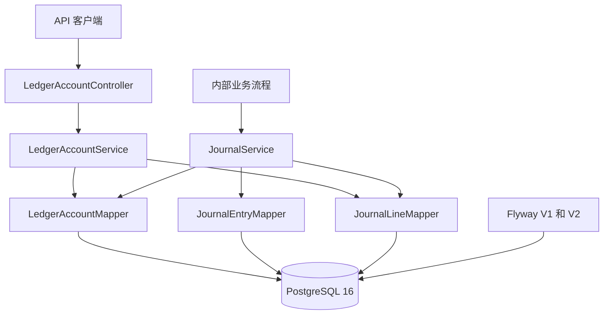
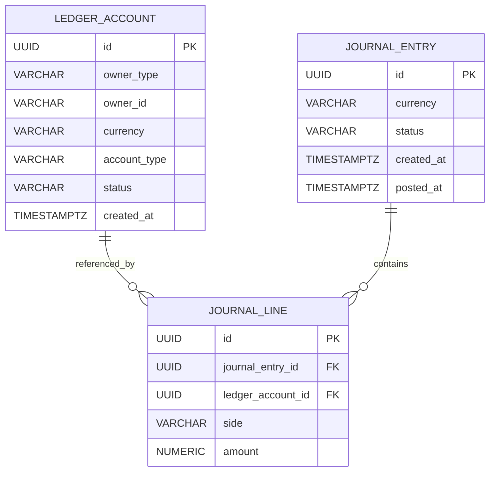
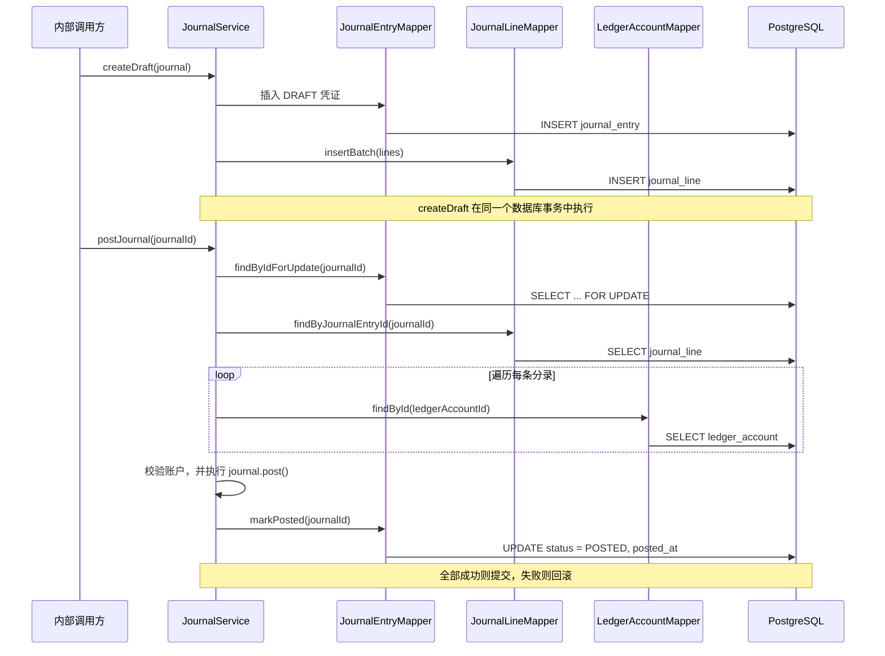

# Ledger Core 架构设计

> **GlobalPay Lab · M1 里程碑 · Issue #10**  
> 实现依据：`backend/src/main/java/com/globalpay/lab/ledger` 及 Flyway V1–V2 迁移文件。  
> 文档范围：**已经实现的 Ledger Core**，不包括尚在规划中的支付、结算、外汇、风控与对账功能。

## 1. 概述

GlobalPay Lab 的 Ledger Core（核心账本模块）采用**复式记账（Double-entry Bookkeeping）**记录资金变动。目前已支持：账本账户的创建与查询、草稿凭证的创建、经过校验的凭证过账、账户余额计算，以及已过账分录的历史查询。

Ledger Core 是基于 Spring Boot 的**模块化单体应用（Modular Monolith）**的一部分，使用 PostgreSQL 持久化数据。它目前用于记录模拟资金变动；GlobalPay Lab 不处理真实资金。

核心设计决策：

- **`JournalEntry` 是记账聚合**：`DRAFT` 状态的凭证可以包含零条或多条 `JournalLine`，但正式过账时至少需要两条分录。
- **借贷平衡**：每张成功过账的凭证，其 Debit 总额必须等于 Credit 总额。
- **事务原子性**：Journal Posting 由 Spring 管理的数据库事务执行，确保操作要么整体成功，要么回滚。
- **已过账记录不可修改**：PostgreSQL Trigger 保护 `POSTED` 状态的凭证及其分录。
- **余额按需计算**：账户余额由已过账的分录汇总得出，不在账户表中维护可变的余额字段。
- **精确金额表示**：Java 使用 `BigDecimal`，PostgreSQL 使用 `NUMERIC(24,8)`。

## 2. 应用架构



| 包 / 组件 | 职责 |
|---|---|
| `ledger.api` | 提供账户创建、查询、余额查询和历史流水查询的 REST 接口 |
| `ledger.api.dto` | 定义 API 请求与响应的数据结构 |
| `ledger.application.LedgerAccountService` | 负责账户操作、按账户类型计算余额，以及查询历史分录 |
| `ledger.application.JournalService` | 负责草稿凭证创建、过账校验和事务性持久化 |
| `ledger.application.query` | 存放只读查询模型 `JournalHistoryRecord` |
| `ledger.domain` | 定义账本账户、会计凭证、借贷分录、状态、账户类型与记账规则 |
| `ledger.infrastructure` | 存放 MyBatis Mapper 接口及自定义 TypeHandler |
| `resources/mapper` | 存放账户、凭证和分录相关的 SQL 映射 |
| `resources/db/migration` | 存放 Flyway 数据库版本迁移及数据保护逻辑 |

**特别说明：** `JournalService.createDraft()` 和 `JournalService.postJournal()` 目前是**内部 Service 方法**，系统尚未提供创建或过账 Journal 的 REST API。

## 3. 领域模型与数据库结构

### 3.1 核心实体

- **`LedgerAccount`（账本账户）**：表示归属于 `USER`、`MERCHANT`、`PLATFORM` 或 `PARTNER` 的账户。每个账户有一个币种、一种账户类型，以及 `ACTIVE`、`FROZEN` 或 `CLOSED` 状态。
- **`JournalEntry`（会计凭证）**：表示一笔完整的记账事务，具有 `DRAFT` 和 `POSTED` 两种状态，记录币种、创建时间以及正式过账后的过账时间。
- **`JournalLine`（会计分录）**：记录某个账本账户的一笔 Debit 或 Credit 变动。每条分录归属于一张凭证，并保存大于零的精确金额。

### 3.2 实体关系图（ERD）



`journal_line.journal_entry_id` 通过外键关联 `journal_entry.id`；`journal_line.ledger_account_id` 关联 `ledger_account.id`。两个外键都采用 `ON DELETE RESTRICT`。

草稿凭证允许暂时没有分录，但只有通过应用层的最少分录数及借贷平衡检查，才能正式过账。

数据库将 `journal_line.amount` 保存为 `NUMERIC(24,8)`，并要求金额严格大于零。`ledger_account` 表中没有可直接修改的余额字段。

## 4. 复式记账规则

每条 `JournalLine` 都有一个记账方向：`DEBIT`（借方）或 `CREDIT`（贷方）。**借方和贷方并不天然等于增加或减少**，具体效果取决于账户类型。

| 账户类型 | 正常余额方向 | 余额计算公式 |
|---|---|---|
| `ASSET`（资产） | Debit | 借方总额 − 贷方总额 |
| `EXPENSE`（费用） | Debit | 借方总额 − 贷方总额 |
| `LIABILITY`（负债） | Credit | 贷方总额 − 借方总额 |
| `REVENUE`（收入） | Credit | 贷方总额 − 借方总额 |
| `EQUITY`（权益） | Credit | 贷方总额 − 借方总额 |

**示例：** 假设平台模拟收到 AUD 100，并代商户保管该笔资金。

| 账户 | 账户类型 | 记账方向 | 金额（AUD） |
|---|---|---|---:|
| 平台现金账户（Platform Cash） | `ASSET` | `DEBIT` | 100.00 |
| 应付商户资金（Merchant Funds Owed） | `LIABILITY` | `CREDIT` | 100.00 |

借方总额 = AUD 100.00；贷方总额 = AUD 100.00。平台的现金资产增加，同时平台对商户的负债也增加。这只是**会计示例**，并不代表目前已经实现了 Payment API 的支付流程。

## 5. Journal 生命周期与过账流程



### 5.1 创建草稿（Draft Creation）

`JournalService.createDraft(JournalEntry)` 首先确认传入的 Journal 处于 `DRAFT` 状态，然后写入凭证和分录。方法使用 `@Transactional`，如果持久化过程中发生错误，事务将回滚。

### 5.2 正式过账（Posting Validation）

`JournalService.postJournal(UUID)` 的执行顺序如下：

1. 通过 `SELECT ... FOR UPDATE` 查询并锁定 Journal，确认它存在且状态为 `DRAFT`。
2. 加载对应的分录，检查每个关联账户均存在、处于 `ACTIVE` 状态，并且账户币种与 Journal 币种一致。
3. 调用 `JournalEntry.post()`，验证分录数量至少为 **2**，且借方总额与贷方总额相等。
4. 通过 Mapper 将 Journal 状态更新为 `POSTED`，同时设置 `posted_at`。
5. 整个事务成功后提交；发生运行时异常则回滚。

目前 `markPosted` 使用以下表达式设置过账时间：

```sql
posted_at = GREATEST(clock_timestamp(), created_at)
```

它保证持久化的过账时间不会早于创建时间，并缓解 JVM 与数据库时钟之间微小偏差所造成的约束失败。

### 5.3 数据库保护机制

Flyway V1 建立主键、外键、合法状态、借贷方向及正金额等约束。Flyway V2 进一步增加：

- **JournalLine Trigger**：禁止对已过账 Journal 所属分录执行 `INSERT`、`UPDATE` 或 `DELETE`。
- **JournalEntry Trigger**：禁止修改或删除**已经处于 `POSTED` 状态**的 Journal。
- **父记录行锁**：JournalLine Trigger 通过 `SELECT ... FOR UPDATE` 锁定所属 Journal，与过账事务协调并发修改。

**约束边界：** 借贷总额相等、分录数量不少于两条，主要由 **Java 过账流程**进行校验。当前 PostgreSQL Trigger **并未覆盖所有直接通过 SQL 将 DRAFT 改为 POSTED 的情况**。因此，不能将应用层规则误写成数据库层已经全面强制保证的约束。

## 6. 余额与历史流水查询

### 6.1 账户余额（Balance Query）

`LedgerAccountMapper.sumDebitMinusCredit(accountId)` 先计算原始净变动：

```sql
SELECT COALESCE(
    SUM(CASE WHEN jl.side = 'DEBIT' THEN jl.amount ELSE -jl.amount END),
    0
)
FROM journal_line jl
JOIN journal_entry je ON je.id = jl.journal_entry_id
WHERE jl.ledger_account_id = :accountId
  AND je.status = 'POSTED';
```

`LedgerAccountService.getBalance(accountId)` 会先验证账户存在，再根据第 4 节的账户类型规则决定是否反转净额符号。

只有 `POSTED` 分录参与余额计算；`DRAFT` 凭证不影响余额；没有已过账分录的账户返回零。余额在查询时动态计算，目前没有独立的余额缓存或持久化余额字段。

### 6.2 账户分录历史（Journal History Query）

`JournalLineMapper.findHistoryByAccountId(accountId)` 只返回**属于指定账户的已过账分录**，而不是返回同一张 Journal 中所有账户的分录。

| 字段 | 含义 |
|---|---|
| `journalId` | 所属完整会计凭证的标识 |
| `lineId` | 当前这条具体分录的唯一标识 |
| `side` | `DEBIT` 或 `CREDIT` |
| `amount` | 精确分录金额 |
| `postedAt` | 所属 Journal 的过账时间 |

查询结果按 `posted_at DESC` 排序，时间相同时再使用 Journal ID、Line ID 保证顺序稳定。同一张凭证中的多条分录可以拥有相同的 `journalId`，但 `lineId` 不同。

REST 响应还会包含账户 ID、币种、账户类型，以及由上述记录构成的 `entries` 列表。当前查询尚未实现分页。

## 7. 已实现接口与功能范围

下列 REST API **已经实现**。完整请求与响应示例将在独立的 API 文档中说明。

| 方法 | 路径 | 用途 |
|---|---|---|
| `POST` | `/api/v1/ledger/accounts` | 创建账本账户 |
| `GET` | `/api/v1/ledger/accounts` | 查询账户列表 |
| `GET` | `/api/v1/ledger/accounts/{id}` | 查询指定账户 |
| `GET` | `/api/v1/ledger/accounts/{id}/balance` | 查询账户余额 |
| `GET` | `/api/v1/ledger/accounts/{id}/journals` | 查询已过账的账户分录历史 |

Journal 创建与过账目前**没有对外 REST API**；其内部调用入口分别是 `JournalService.createDraft(journal)` 和 `JournalService.postJournal(journalId)`。

支付处理、退款、外部结算、对账、外汇、风控、生产部署和账户访问授权，**均不属于目前已实现的 M1 Ledger Core**。

## 8. 测试与验证

Ledger Core 目前通过 JUnit + Mockito 单元测试、PostgreSQL Testcontainers 数据库集成测试，以及 MockMvc API 集成测试进行验证。GitHub Actions CI 会在针对 `dev` 的 Pull Request 上运行后端 Maven 校验以及前端 Lint / Build。

本地环境的具体启动方法，以及 API 请求和响应样例，将在后续 Ledger API 和本地开发文档中补充。
