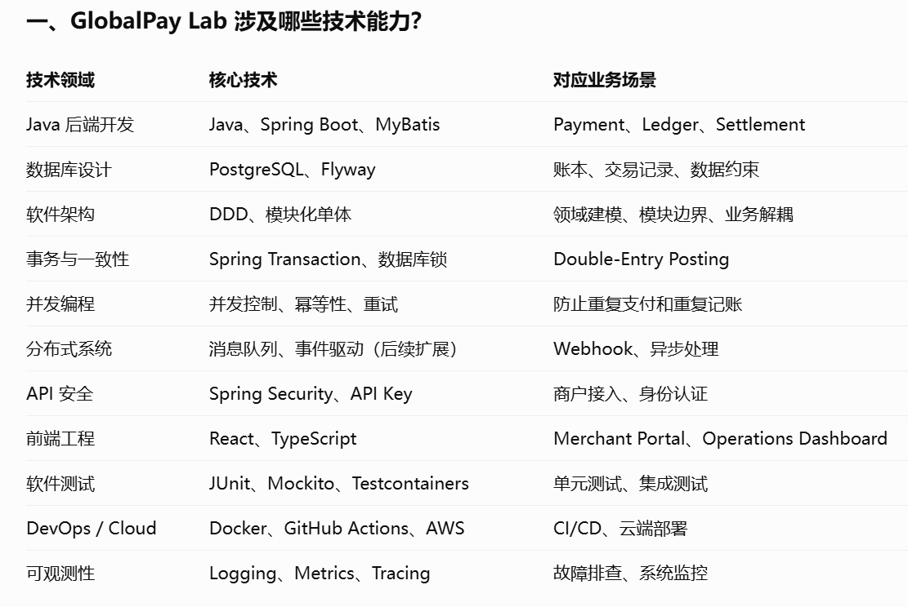
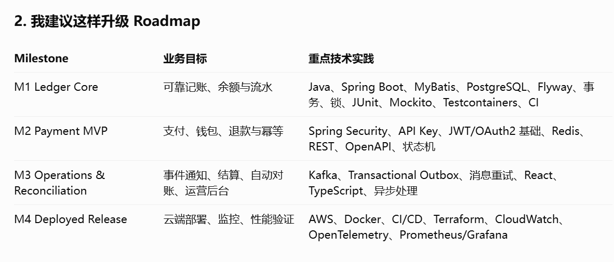

# GlobalPay Lab — Development Roadmap

## Project Goal

Build a realistic sandbox platform demonstrating the core capabilities of B2B payment infrastructure, including payment processing, double-entry ledgering, settlement, automated reconciliation, and operational visibility.

**Architecture:** Java / Spring Boot modular monolith, PostgreSQL, React, Docker, and AWS.

**Delivery strategy:** Complete and verify one milestone before creating implementation tickets for the next.

---

## M1 — Ledger Core

**Status:** In Progress

**Goal:** Build a reliable and auditable double-entry ledger.

### Scope

- Ledger account management
- Journal creation and posting
- Debit and credit validation
- Transaction atomicity and ledger invariants
- Account balance calculation
- Journal history queries
- Integration testing
- CI verification
- Ledger architecture documentation

### Existing GitHub Issues

- #2–#5: Completed
- #6: Enforce ledger invariants and atomicity
- #7: Implement balance and journal history queries
- #8: Add ledger integration tests
- #9: Add CI build and verification workflow
- #10: Document ledger architecture and APIs

### Definition of Done

- Valid journals are posted successfully.
- Invalid journals are rejected without partial writes.
- Posted journal data is protected against unauthorized modification.
- Account balances and transaction histories are accurate.
- Core integration tests pass consistently.
- CI validates pull requests.
- Ledger architecture and usage are documented.
- Known blocking defects are resolved.

---

## M2 — Payment MVP v0.1

**Status:** Planned

**Goal:** Implement an end-to-end sandbox payment lifecycle backed by the Ledger Core.

### Scope

- Merchant identity and sandbox API keys
- Multi-currency wallets
- PaymentIntent domain model and state machine
- Payment creation and query APIs
- Idempotent payment requests
- Mock payment provider integration
- Payment-to-ledger integration
- Refunds and ledger reversals
- Basic payment operations view
- End-to-end payment tests

### Definition of Done

A merchant can submit a simulated payment through an authenticated API. The system processes the payment, prevents duplicate requests, records the correct ledger movements, and supports refunds without modifying posted financial history.

**Ticket creation:** After M1 acceptance.

---

## M3 — Operations & Reconciliation v0.2

**Status:** Planned

**Goal:** Build the financial operations capabilities required to investigate and reconcile simulated payments.

### Scope

- Signed webhooks and delivery retries
- Settlement batch processing
- Provider fees and net settlement calculations
- CSV settlement file import
- Automated transaction reconciliation
- Reconciliation exception management
- Basic rule-based risk alerts
- Audit logs
- React operations dashboard

### Definition of Done

The platform can ingest simulated settlement records, reconcile them against internal payments, identify discrepancies, and present the results in an operations dashboard.

**Ticket creation:** After M2 acceptance.

---

## M4 — Deployed Release v1.0

**Status:** Planned

**Goal:** Deliver a deployable, observable, and demonstrable FinTech sandbox.

### Scope

- Docker-based application packaging
- AWS deployment
- CI/CD pipeline
- Environment configuration and secrets management
- Application health checks and monitoring
- OpenAPI documentation
- Demonstration merchant and sample data
- End-to-end regression testing
- Architecture diagrams and technical documentation
- English project demonstration

### Definition of Done

The sandbox is accessible in a hosted environment, the core payment and reconciliation scenarios work end-to-end, automated checks pass, and the system can be demonstrated and explained to prospective employers.

**Ticket creation:** After M3 acceptance.

---

## Future Backlog

The following are optional enhancements outside the initial MVP:

- Advanced distributed concurrency and resilience
- Kafka-based event processing
- Redis-based caching and rate limiting
- Multi-provider payment routing
- Advanced FX capabilities
- Enhanced risk and fraud detection
- Microservice extraction
- Performance and load engineering

These capabilities should be introduced only when justified by a concrete engineering requirement.

## Development Workflow

1. Select the current milestone.
2. Implement its GitHub Issues through feature branches and pull requests.
3. Run the required unit, integration, and CI checks.
4. Validate milestone acceptance criteria.
5. Resolve blocking defects and update documentation.
6. Close the milestone.
7. Create and prioritize tickets for the next milestone.

**Rule:** Do not expand the active milestone merely to introduce additional technologies.

